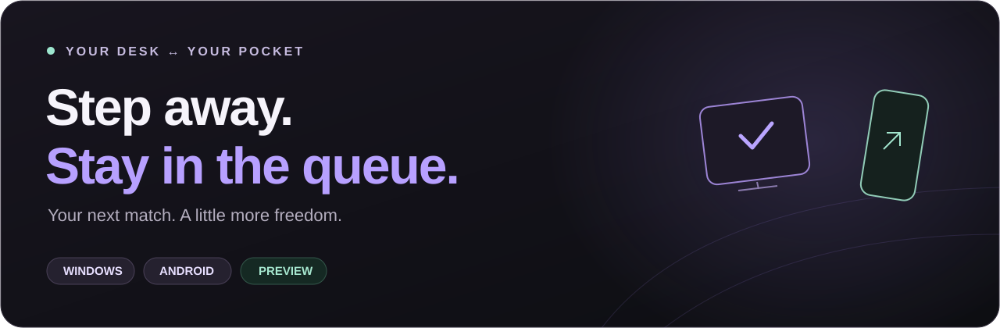
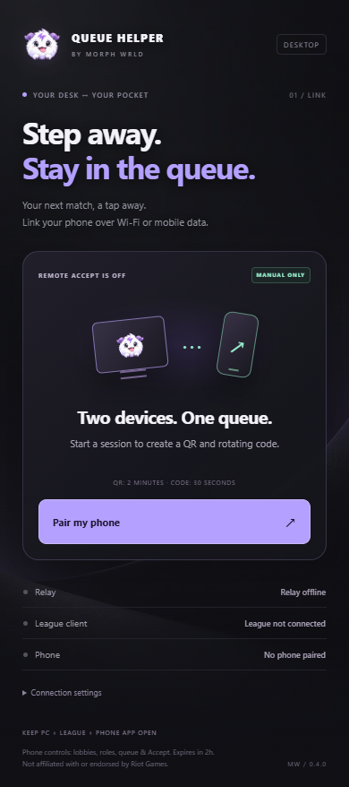
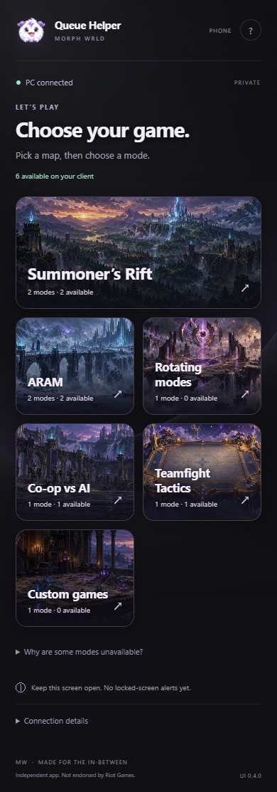
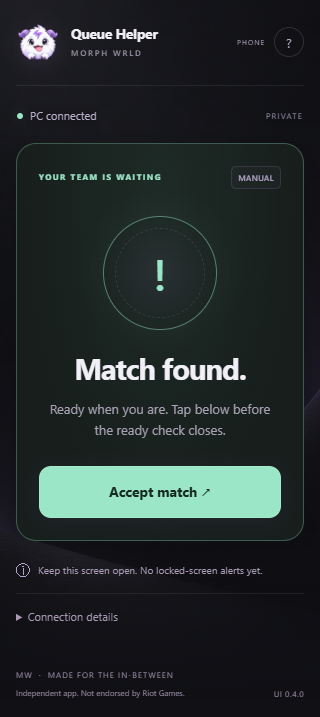
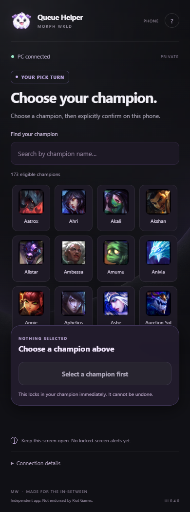
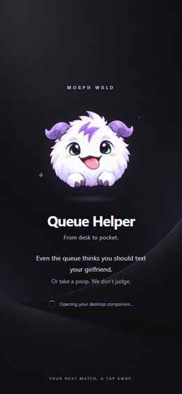

  

<h1 align="center">MW — Queue Helper</h1>

<strong>YOUR DESK ↔ YOUR POCKET</strong> By MORPH WRLD

  <strong>Grab a snack. Stretch your legs. Text your girlfriend.</strong> 
  Your next League match is still one manual tap away.

  <a href="https://github.com/sdkzew/mw-queue-helper-downloads/releases/tag/v0.4.0-preview"><strong>↓ Windows EXE</strong></a>
  &nbsp; · &nbsp;
  <a href="https://github.com/sdkzew/mw-queue-helper-downloads/releases/tag/v0.4.0-preview"><strong>↓ Android APK</strong></a>
  &nbsp; · &nbsp;
  <a href="#get-connected-in-a-minute">Quick start</a>
  &nbsp; · &nbsp;
  <a href="#before-you-download">Preview notes</a>

---

## Two devices. One queue.

MW — Queue Helper links your Windows PC and phone so you can manage supported League lobbies and respond to a ready check without staying glued to your desk. **You stay in control: every game action requires your tap.**

| Your desktop companion | Your pocket control room |
| :---: | :---: |
|  |  |
| Open it on Windows and pair your phone. | Browse the modes available on your connected client. |

*Screenshots use simulated demo states. Mode availability and champion eligibility come from your live League client; the preview is not proof of compatibility with every queue.*

## A little freedom between games

| Feature | What you can do |
| --- | --- |
| **Pair your way** | Scan a QR or enter a five-digit code that refreshes every 30 seconds. Code pairing also needs your approval on Windows. |
| **Wi-Fi or mobile data** | Connect over the HTTPS relay; your phone does not have to share the PC's Wi-Fi. Both devices need Internet access. |
| **Pick a game** | Explore available categories, choose a supported mode and explicitly create its lobby. |
| **Set your roles** | Choose primary and secondary roles where the queue supports them, then save. |
| **Start your queue** | Start matchmaking in an eligible lobby you lead. No automatic queuing. |
| **Accept from your phone** | Tap **Accept match** when the ready check appears. Return to your PC in time to play. |
| **Your turn. Your champion.** | Search eligible portraits and explicitly confirm your own champion ban or lock-in during supported drafts. |
| **Meet Queue Buddy** | A fluffy companion, graphite-and-violet UI and a gently animated startup, with reduced-motion support. |

### Ready when you are

| Match found | Champion select |
| :---: | :---: |
|  |  |
| One clear button. One manual tap. | Choose a portrait, then separately confirm. Nothing auto-locks. |

<strong>A tiny loading-screen break</strong>

> “Even the queue thinks you should text your girlfriend. Or take a poop. We don’t judge.”

This animation is a deliberately held demo. Normal startup has a short readable intro, a Skip option and an urgent-match bypass.

## Get connected in a minute

1. **Open League on your PC.** Launch the Windows Queue Helper EXE and keep both running.
2. **Open Queue Helper on Android.** Install the preview APK from the release page, or use your phone's browser via the desktop QR.
3. **Pair your phone.** Scan the QR, or type the current five-digit code and approve your own request on Windows. Never approve an unexpected request.
4. **Choose your next game.** Select an available mode, create a supported lobby, save roles if needed and tap **Start queue**—or queue directly on your PC.
5. **Keep the phone app visible.** When prompted, tap **Accept match**. Supported ban/pick turns have their own explicit confirmation.

End the session on Windows when you are finished. Sessions expire after two hours; QR claims expire after two minutes.

## Before you download

**This is an early preview, not a production or Riot-approved release.**

- **Keep the phone app open and visible.** Background, push and locked-screen alerts are not implemented. Your PC, League and Internet connection must stay on.
- **Windows:** v0.4.0, Windows 10/11 x64 with WebView2. The EXE is not code-signed; there is no installer or automatic updater. Do not disable Windows security protections.
- **Android:** v0.3.3 preview shell, Android 8+. It loads the hosted v0.4.0 interface, so the different version numbers are intentional. It is debug-signed but non-debuggable, requests Internet access only and is not a Play Store release. Do not disable Play Protect. An existing compatible install can be updated without uninstalling.
- **iPhone:** no native iOS app yet. The browser interface is a baseline, not a guarantee of iPhone compatibility or background operation.
- **No automation:** no auto-accept, auto-ban, auto-pick or auto-queue. No skins, loadouts, champion trades, arbitrary custom-game setup or bypassing queue/account restrictions.
- **Testing:** automated UI/relay/native checks use fixtures. Physical-phone installation, real ready checks and real champion turns still need user-assisted verification. Live compatibility and account safety are not guaranteed.
- **Shared relay:** the current service has personal-prototype capacity and strict global pairing limits. Availability is not guaranteed; this is not a scaled public service.

[Download preview files and SHA-256 checksums →](https://github.com/sdkzew/mw-queue-helper-downloads/releases/tag/v0.4.0-preview)

## Your accounts stay yours

No Riot password is requested. Riot credentials, the local client credential, player lists and chat are not sent to the relay. Pairing grants a temporary, narrow remote-control session—not remote desktop access. There are no third-party analytics or trackers in the interface.

Treat the pairing QR/link as a secret. Keep both devices trusted and use **End session & revoke access** when finished. HTTPS and expiring sessions do not make a compromised PC safe.

## Downloads are public. App source is private.

The public download repository contains presentation files and compiled release assets only. The application's source and development history are maintained separately in a **private repository**. No open-source license for the app is granted here.

GitHub's automatically generated **Source code (zip/tar.gz)** links in the download repository contain only that repository's README and images—not the private application's source. The **EXE** and **APK** are the files to install.

Compiled apps can still be inspected or reverse-engineered, and the hosted phone interface necessarily sends HTML, CSS and JavaScript to the browser. Private hosting of the source repository is not a promise of absolute code secrecy.

## Independent by design

Created by **MORPH WRLD** · [sdkzew](https://github.com/sdkzew). Queue Buddy is fan-inspired artwork, not an official Riot character. Third-party components and Riot assets retain their respective rights and terms.

MW — Queue Helper isn’t endorsed by Riot Games and doesn’t reflect the views or opinions of Riot Games or anyone officially involved in producing or managing Riot Games properties. Riot Games, League of Legends and associated properties are trademarks or registered trademarks of Riot Games, Inc.

The [League Client API](https://developer.riotgames.com/docs/lol#league-client-api) is unsupported and may change. This preview does not claim Riot registration, approval or review. Applicable [Riot developer policies](https://developer.riotgames.com/policies/general) and product review still need to be addressed before treating this as a general-distribution product.

---

<strong>MW — MADE FOR THE IN-BETWEEN.</strong> Less waiting at your desk. Still your call.

